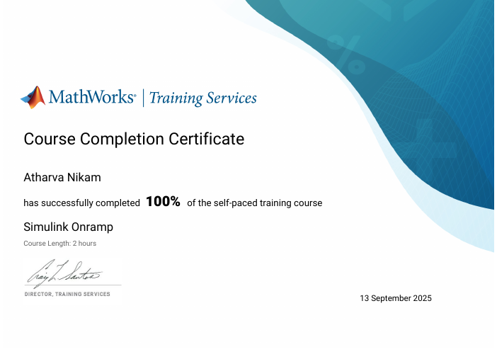
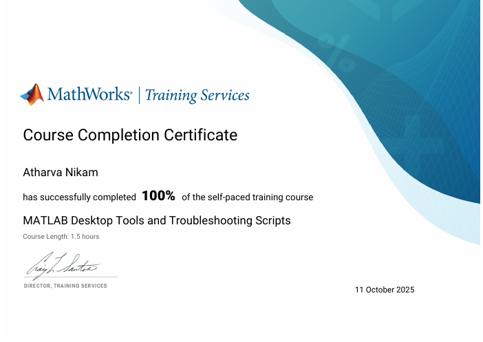
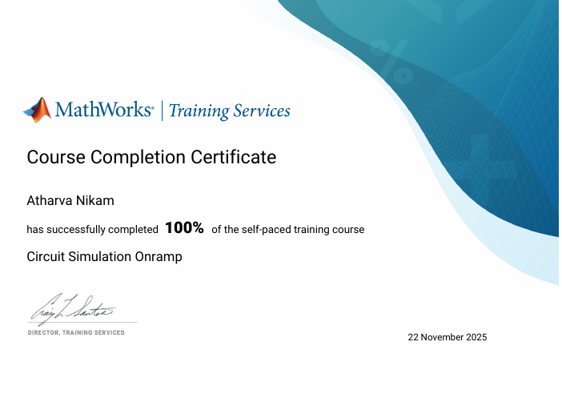

# Certifications

A collection of my professional training certificates. All certificates are stored as the original PDFs issued by the training provider.

---

## MathWorks — MATLAB Academy (Self-Paced Training)

Seven MathWorks *Training Services* course completion certificates, covering MATLAB programming, Simulink modeling, physical modeling with Simscape, electrical circuit simulation and motor control — the toolchain behind my EV powertrain, battery thermal and control projects.

| # | Course | Completed | Duration | Focus Area | Certificate |
|---|--------|-----------|----------|------------|-------------|
| 1 | MATLAB Onramp | 7 May 2025 | 2 h | MATLAB fundamentals | [PDF](MathWorks/01_MATLAB_Onramp.pdf) |
| 2 | Simulink Onramp | 13 Sep 2025 | 2 h | Simulink modeling & simulation | [PDF](MathWorks/02_Simulink_Onramp.pdf) |
| 3 | MATLAB Desktop Tools and Troubleshooting Scripts | 11 Oct 2025 | 1.5 h | MATLAB workflow & debugging | [PDF](MathWorks/03_MATLAB_Desktop_Tools_and_Troubleshooting_Scripts.pdf) |
| 4 | Introduction to Motor Control | 1 Nov 2025 | 1 h | Electric motor control | [PDF](MathWorks/04_Introduction_to_Motor_Control.pdf) |
| 5 | Simscape Onramp | 6 Nov 2025 | 1 h | Physical / multidomain modeling | [PDF](MathWorks/05_Simscape_Onramp.pdf) |
| 6 | Circuit Simulation Onramp | 22 Nov 2025 | 1.5 h | Electrical circuit simulation | [PDF](MathWorks/06_Circuit_Simulation_Onramp.pdf) |
| 7 | The Simulink Environment | 17 Jul 2026 | 1.5 h | Simulink environment & model management | [PDF](MathWorks/07_The_Simulink_Environment.pdf) |

**Issuer:** MathWorks Training Services · **Format:** self-paced online courses, 100 % completion

---

### Course Overview

**1. MATLAB Onramp**
Core MATLAB skills: commands and the MATLAB desktop and editor, vectors and matrices, array indexing and calculations, function calls, documentation, plotting, data import, logical arrays and basic programming, finished with a final project.

**2. Simulink Onramp**
Building, editing and simulating block-diagram models in Simulink — the basis for the controller and plant models in my projects.

**3. MATLAB Desktop Tools and Troubleshooting Scripts**
Using the MATLAB desktop tools efficiently and finding and fixing problems in scripts.

**4. Introduction to Motor Control**
Fundamentals of electric motor control, relevant to traction-motor modeling in EV powertrains.

**5. Simscape Onramp**
Physical modeling of multidomain systems with Simscape — used for the Simscape Fluids battery cooling plant in my Predictive EV Cooling project.

**6. Circuit Simulation Onramp**
Modeling and simulating electrical circuits with Simscape Electrical components.

**7. The Simulink Environment**
Working effectively in the Simulink environment: navigating, organizing and managing models.

---

### Certificate Gallery

| | |
|---|---|
| <a href="MathWorks/01_MATLAB_Onramp.pdf"></a><br>**MATLAB Onramp** | <a href="MathWorks/02_Simulink_Onramp.pdf"></a><br>**Simulink Onramp** |
| <a href="MathWorks/03_MATLAB_Desktop_Tools_and_Troubleshooting_Scripts.pdf"></a><br>**MATLAB Desktop Tools and Troubleshooting Scripts** | <a href="MathWorks/04_Introduction_to_Motor_Control.pdf"></a><br>**Introduction to Motor Control** |
| <a href="MathWorks/05_Simscape_Onramp.pdf"></a><br>**Simscape Onramp** | <a href="MathWorks/06_Circuit_Simulation_Onramp.pdf"></a><br>**Circuit Simulation Onramp** |
| <a href="MathWorks/07_The_Simulink_Environment.pdf"></a><br>**The Simulink Environment** | |

---

### Applied in Projects

- [Predictive Electric Vehicle Cooling](https://github.com/atharvaajaynikam4601-netizen/Predictive-Electric-Vehicle-Cooling) — Simulink, Simscape Fluids, MPC
- [EV Powertrain Dynamics, Battery Modeling and SOC Estimation](https://github.com/atharvaajaynikam4601-netizen/EV-Powertrain-Dynamics-Battery-Electrical-Thermal-Modeling-and-SOC-Estimation-using-Kalman-Filter-) — MATLAB
- [P4 Hybrid Powertrain Energy Management](https://github.com/atharvaajaynikam4601-netizen/P4-Hybrid-Powertrain-Energy-Management) — MATLAB

---

## Repository Structure

```
README.md
MathWorks/
  01_MATLAB_Onramp.pdf ... 07_The_Simulink_Environment.pdf   Original certificates
  previews/                                                   PNG previews used in this README
```

**Profile:** [LinkedIn — Licenses & certifications](https://www.linkedin.com/in/atharva--nikam/details/certifications/)
